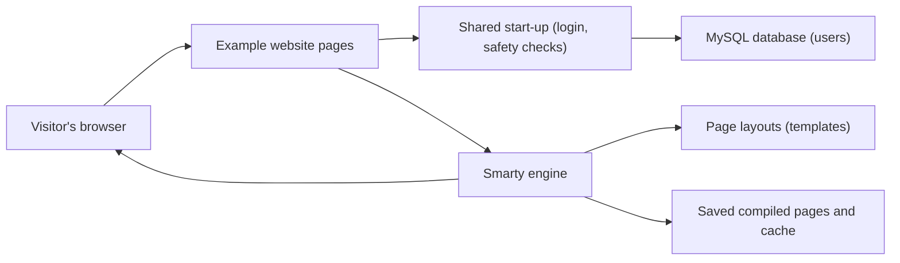

# About this project — smarty-php-template-engine-archive
Date: 2026-11-20 · Part of the code review · Start with the [reviewed outcomes](REVIEWED-OUTCOMES.md)

## What this project is
This is a saved copy of Smarty, a well-known "template engine" (a tool that fills web page layouts with data) for the PHP programming language. Its README says it is kept as a historical archive for reference, not as an original application. Web developers use Smarty to keep the look of a page (HTML) apart from the program logic. The project has three main pieces: the engine itself (`libs/`), the grammar files the engine's reader is built from (`lexer/`), and a small example website (`demo/`) where people log in and manage a list of users.

## How it works
1. A PHP web page creates a Smarty object and hands it some data, for example a list of users.
2. It asks Smarty to show a template (a `.tpl` file: an HTML page with placeholders like `{$name}`).
3. The first time, Smarty reads the template and turns it into a plain PHP file ("compiling"), which it saves in a work folder (`templates_c/`).
4. The next times, Smarty runs that saved PHP file directly, which is faster. It can also save the finished page in a cache folder (`cache/`).
5. Plugins (small add-ons in `libs/plugins/`) add extra helpers, such as date formatting or building drop-down lists.
6. In the example website, every page first runs a shared start-up file (`demo/bootstrap.php`). It sets up the login session, connects to a MySQL database and prepares Smarty.
7. The pages then read or change rows in the database's user table and show the result through Smarty templates.

## Size and activity
In the current working copy there are about 240 files and about 40,000 lines — a medium-sized project. Almost all of it is PHP (a common language for websites): about 218 PHP files and 33,000 lines, of which the engine is about 200 files and 31,000 lines. The rest is a few templates (about 640 lines), grammar files (about 2,600 lines) and documentation, mainly a long change log (about 3,500 lines). The history is very short: the first change is dated 2021-10-30, the last committed change 2026-07-25, with 3 changes in total. There are also many changes that are not committed yet: a second copy of the engine inside `demo/libs/` (213 files, about 33,000 lines) is being removed, and the example website, its templates and the automatic check setup are being reworked. Testing is light: one small "smoke test" (a quick check that the basics work) in `tests/smoke_test.php`, which the automatic build checks run together with a PHP syntax check.

## What is in which folder
| Folder | What it contains (plain words) |
|---|---|
| `libs/` | The Smarty engine: the main entry file and the start-up helpers |
| `libs/sysplugins/` | The engine's inner workings: reading templates, turning them into PHP, caching, security settings |
| `libs/plugins/` | Ready-made helpers usable inside templates (formatting text, dates, lists, forms) |
| `lexer/` | Grammar descriptions from which the template reader is generated |
| `demo/` | Example user-management website (log in, list, add, edit, delete users) |
| `demo/templates/` | The page layouts for the example website |
| `demo/plugins/` | Example add-ons, such as storing templates or cache in a database or memory store |
| `demo/configs/` | An example settings file for templates |
| `demo/templates_c/`, `demo/cache/` | Work folders where Smarty saves compiled pages and cached pages |
| `tests/` | The single smoke test |
| `.github/workflows/` | Automatic checks that run on every change (GitHub Actions) |

## Most important files
- `libs/Smarty.class.php` — the main entry point of the engine and its settings; everything starts here.
- `libs/bootstrap.php` and `libs/Autoloader.php` — load the engine's parts when needed; needed for it to run at all.
- `libs/sysplugins/smarty_internal_templatecompilerbase.php` — turns templates into PHP; the core of how Smarty works.
- `libs/sysplugins/smarty_internal_templateparser.php` — reads and understands template text; the largest file (about 2,900 lines), generated from the grammar.
- `libs/sysplugins/smarty_internal_templatelexer.php` — splits template text into pieces for the reader; also generated.
- `libs/sysplugins/smarty_internal_template.php` — represents one template while it is being shown.
- `libs/sysplugins/smarty_security.php` — rules that limit what templates may do; matters when templates come from less-trusted people.
- `lexer/smarty_internal_templateparser.y` — the grammar source for the template reader; changes to the reader must start here.
- `demo/bootstrap.php` — shared start-up of the example site: errors, session, database, login, form protection.
- `demo/config.php` — settings of the example site; reads the database login from server settings.
- `demo/login.php` — the example site's login page.
- `demo/edit.php`, `demo/insert.php`, `demo/delete.php`, `demo/view.php` — the pages that change or list users.
- `tests/smoke_test.php` — the only automatic test.
- `.github/workflows/ci.yml` — the automatic check setup and the PHP versions it checks against.
- `composer.json` — the package description: name, required PHP version and tools.

## What it is built with
| Part | What it is (plain words) | Version in use | Found in |
|---|---|---|---|
| PHP | The programming language everything is written in | 7.1 or newer, or 8.x (`^7.1 \|\| ^8.0`) | `composer.json`; README says "PHP 7.1 to PHP 8.0" |
| Smarty | The template engine this project is | 4.0.0-rc.0 (a "release candidate", meaning a test version before the final release) | `libs/Smarty.class.php`, line 101; `CHANGELOG.md` (dated 2021-10-13) |
| Smarty copy in `demo/libs/` | A second copy of the engine (being removed, not committed yet) | 4.0.0-rc.0 | `demo/libs/Smarty.class.php` in the last commit |
| Composer | PHP's package manager, used to install the engine | not stated | `composer.json` |
| PHPUnit | A tool for running automatic tests (only for developers) | `^8.5 \|\| ^7.5` | `composer.json` (require-dev) |
| smarty-lexer | Tool that generates the template reader from the grammar files (only for developers) | `^3.1` | `composer.json` (require-dev) |
| MySQL | The database the example website uses (a database named `staah`, table `user`) | not stated | `demo/bootstrap.php`, line 90; `demo/README.md` |
| PDO | PHP's built-in way to talk to databases | comes with PHP | `demo/bootstrap.php`, lines 90–97 |
| GitHub Actions | The service that runs the automatic checks | `actions/checkout@v2`, `shivammathur/setup-php@v2` | `.github/workflows/ci.yml` |
| PHP versions checked | The PHP versions the automatic checks try | 7.1, 7.2, 7.3, 7.4, 8.0 (plus 8.0 with the faster "JIT" mode) | `.github/workflows/ci.yml` |
| Licence | The terms for using the code | LGPL-3.0 | `composer.json`, `LICENSE` |

Versions are read from the project files. Whether they are still supported was not checked online in this review.

### What we could not check
- Nothing was installed or run, so we could not confirm the engine or the example site actually work with a given PHP version.
- The example website's database layout is only described in `demo/README.md`; there is no database setup file in the project.
- The MySQL and Composer versions are not stated anywhere in the project.
- Much of the current state is uncommitted work, so this description may change once those changes are committed or dropped.

<!-- based-on: 410e12c6f86b559a8d566604eefbbaedd6d29ba5 -->
