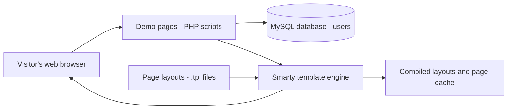

# About this project — smarty-php-template-engine-archive
Date: 2026-11-20 · Part of the code review · Start with the [reviewed outcomes](REVIEWED-OUTCOMES.md)

## What this project is
This is a stored copy of Smarty, a well-known "template engine" (a tool that fills page layouts with data to make web pages) for the PHP language. Smarty keeps the look of a page (HTML, the language of web pages) apart from the program logic behind it. The README says it is kept as a historical archive and is not original work of the repository owner. Next to the engine, there is a small demo website that uses a MySQL database (a common data store) to log in, list, add, edit and delete users. It is probably meant for learning and reference, not for live use.

## How it works
1. A visitor opens a page of the demo website, for example the login page (`demo/login.php`).
2. The page's PHP script reads the visitor's input and, where needed, talks to the MySQL database (connection set up in `demo/config.php`).
3. The script hands the data to Smarty and names a layout file, for example `login.tpl` in `demo/templates/`.
4. Smarty reads that layout and "compiles" it (turns it once into ready-to-run PHP code), stored in `demo/templates_c/`.
5. Smarty runs the compiled code with the data and sends the finished web page back to the visitor.
6. If caching is switched on, Smarty also keeps a finished copy of the page in `demo/cache/`, so it can answer faster next time.
7. The rules for reading layout files come from grammar files in `lexer/`, which are turned into the reader parts of the engine.

## Size and activity
The project has about 446 files and about 72,800 lines — medium-sized. Almost all of it is PHP (a common language for websites): about 426 PHP files and 65,200 PHP lines. But the engine itself (`libs/`, about 31,300 lines) is stored twice: an exact second copy sits in `demo/libs/`. So the real, unique code is roughly half that size. There are also 9 layout files (`.tpl`), 4 grammar files for the template reader, and a long change history (`CHANGELOG.md`). The git history has 3 changes, the first on 2021-10-30 and the last on 2026-07-25; one file (`demo/login.php`) has an unsaved local change. There are no automated tests in the project. The automatic test setup (`.github/workflows/ci.yml`) calls a test script and test tools that are not included.

## What is in which folder
| Folder | What it contains (plain words) |
|---|---|
| `libs/` | The Smarty engine itself: the main class, the loader and the reader/compiler parts |
| `libs/sysplugins/` | The inner workings of the engine (about 150 files): reading, compiling, caching, security rules |
| `libs/plugins/` | Ready-made helpers for layouts, e.g. date formatting, text cutting, HTML drop-down lists (47 files) |
| `lexer/` | Grammar files that describe the template language; used to generate the reader parts |
| `demo/` | A small user-management demo website (login, list, add, edit, delete users) |
| `demo/libs/` | A full second copy of the Smarty engine, used by most demo pages |
| `demo/templates/` | The page layouts of the demo (login, list, add, edit, header, footer) |
| `demo/templates_c/`, `demo/cache/` | Files Smarty made automatically (compiled layouts and cached pages), saved into git |
| `demo/plugins/` | Extra examples to store layouts or cached pages in MySQL, Memcache, APC or other databases |
| `demo/configs/` | A small settings file read by the demo layouts |
| `.github/workflows/` | Setup for automatic test runs on GitHub (a code-hosting website) |

## Most important files
- `libs/Smarty.class.php` — the main Smarty class; every page starts here. It also holds the version number.
- `libs/bootstrap.php` and `libs/Autoloader.php` — load the engine's files when they are needed.
- `libs/sysplugins/smarty_internal_templatecompilerbase.php` — the core that turns layouts into PHP code.
- `libs/sysplugins/smarty_internal_templateparser.php` — reads and understands the layout language (largest file, about 2,900 lines).
- `libs/sysplugins/smarty_internal_templatelexer.php` — splits layout text into small pieces for the reader.
- `libs/sysplugins/smarty_internal_template.php` — represents one layout while it is being shown.
- `libs/sysplugins/smarty_security.php` — the rules that limit what layouts are allowed to do.
- `lexer/smarty_internal_templateparser.y` — the grammar the layout reader is generated from.
- `demo/config.php` — sets up the demo's connection to the MySQL database.
- `demo/login.php` — the demo login page; checks the user name and password against the database.
- `demo/view.php` — lists all users and handles deleting a user.
- `demo/edit.php` and `demo/insert.php` — change or add a user.
- `demo/index.php` — a feature showcase page; it uses the top-level `libs/` copy, not `demo/libs/`.
- `composer.json` — the project's package description: name, licence and required versions.
- `.github/workflows/ci.yml` — describes the automatic test runs on several PHP versions.

## What it is built with
| Part | What it is (plain words) | Version in use | Found in |
|---|---|---|---|
| PHP | The programming language everything is written in | 7.1 or newer, or 8.x ("^7.1 \|\| ^8.0") | `composer.json` |
| PHP versions tested | The PHP versions the automatic tests were set up to use | 7.1, 7.2, 7.3, 7.4, 8.0 (also 8.0 with "JIT", a speed feature) | `.github/workflows/ci.yml` |
| Smarty | The template engine stored in this project | 4.0.0-rc.0 (a "release candidate", meaning a test version before the final release) | `libs/Smarty.class.php`, line 101; same in `demo/libs/Smarty.class.php`; `CHANGELOG.md` (dated 2021-10-13) |
| MySQL (through "mysqli", PHP's MySQL connector) | The database the demo stores users in | Not stated | `demo/config.php` |
| PHPUnit | A tool for automatic tests (only for developers) | ^8.5 or ^7.5 | `composer.json` |
| smarty-lexer | A tool that turns the grammar files into reader code (only for developers) | ^3.1 | `composer.json` |
| Composer | PHP's package manager (a tool that downloads needed libraries) | Not stated; no lock file in the project | `composer.json` |
| GitHub Actions: checkout | Fetches the code for test runs | v2 | `.github/workflows/ci.yml` |
| GitHub Actions: setup-php | Installs PHP for test runs | v2 | `.github/workflows/ci.yml` |
| GitHub Actions: cache | Keeps downloaded libraries between test runs | v2 | `.github/workflows/ci.yml` |
| Optional cache stores | Places Smarty can keep cached pages: MySQL, PDO (a general database connector), Memcache, APC | Not stated | `demo/plugins/` |
| Licence | The legal terms for using the code | LGPL-3.0 | `composer.json`, `LICENSE` |

Versions are read from the project files. Whether they are still supported was not checked online in this review.

### What we could not check
- No "lock file" (a file that records the exact library versions installed) exists, so exact versions of PHPUnit and smarty-lexer are unknown.
- The MySQL version and the database layout (the `user` table) are not in the project.
- The test script and test files used by the automatic test setup are not included, so we could not see what the tests cover.
- We did not run the demo or the engine (review rules: look only).
